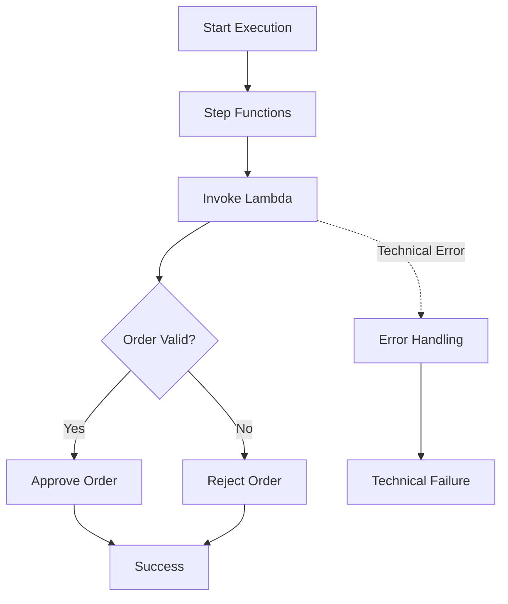

## Building Serverless Workflows with AWS Step Functions and Lambda

   

A hands-on serverless workflow orchestration project using AWS Step Functions and AWS Lambda.

This project demonstrates how to build a simple order-processing workflow using AWS Step Functions to orchestrate Lambda functions, implement conditional branching, handle execution errors, and monitor workflow executions.

### Project Overview

Modern applications often require multiple operations to execute in a specific sequence. Managing these operations individually can introduce complexity, particularly when applications need to handle failures, retries, and conditional execution.

AWS Step Functions simplifies this process by allowing developers to coordinate multiple AWS services through state machines.

In this project, we build an order-processing workflow that validates incoming orders and determines whether they should be approved or rejected.

### Architecture

The solution uses the following AWS services:

- **AWS Step Functions**: Orchestrates the workflow and manages execution states.
- **AWS Lambda**: Executes the order-validation business logic.
- **AWS IAM**: Controls permissions between AWS services.
- **Amazon CloudWatch**: Provides logging and monitoring capabilities.

### Workflow Diagram



### Workflow Description

A user starts a workflow execution with an order payload.
Step Functions invokes the ValidateOrder Lambda function.
Lambda validates the order information.
Step Functions evaluates the validation result using a Choice state.
Valid orders follow the approval path.
Invalid orders follow the rejection path.
Technical execution failures are handled through retry and Catch configurations.

### Repository Structure

```
aws-step-functions-lambda-order-workflow/
│
├── README.md
├── LICENSE
├── .gitignore
│
├── lambda/
│   └── validate_order.py
│
├── statemachine/
│   └── order_processing.asl.json
│
├── events/
│   ├── valid_order.json
│   └── invalid_order.json
│
├── docs/
│   └── architecture.md
│
└── tests/
    └── test_validate_order.py
```

### Prerequisites

Before deploying the project, make sure you have:

An active AWS account.
Access to AWS Management Console.
Permissions to create AWS Lambda functions, Step Functions state machines, and IAM roles.
Python 3.14 or a compatible supported Python environment.
AWS CLI configured if you prefer command-line deployment.

AWS Region: US East (N. Virginia) — us-east-1

All resources should be created in the same AWS Region.

### Getting Started

#### 1. Clone the repository

```bash
git clone https://github.com/YOUR_USERNAME/aws-step-functions-lambda-order-workflow.git

cd aws-step-functions-lambda-order-workflow
```

Replace YOUR_USERNAME with your GitHub username.

#### 2. Create the Lambda function

Create an AWS Lambda function named:

`ValidateOrder`

Use Python 3.14 as the runtime and upload the source code located at:

`lambda/validate_order.py`

Configure an execution role with the basic Lambda logging permissions.

#### 3. Create the Step Functions state machine

Open AWS Step Functions in the AWS Management Console.

Create a new Standard Workflow and use the state machine definition located at:

`statemachine/order_processing.asl.json`

Configure the state machine execution role to allow:

`lambda:InvokeFunction`

on the ValidateOrder Lambda function.

Review the generated IAM permissions before creating the state machine.

#### 4. Execute the workflow

Once the state machine has been created, start a new execution using one of the sample JSON payloads.

Successful order:

`events/valid_order.json`

Expected result:

```json
{
  "status": "APPROVED",
  "order": {
    "orderId": "ORD-1001",
    "total": 149.99
  }
}
```

Rejected order:

`events/invalid_order.json`

Expected result:

```json
{
  "status": "REJECTED",
  "reason": "Invalid order total",
  "order": {
    "orderId": "ORD-1002",
    "total": 0
  }
}
```

### Error Handling

The workflow demonstrates two important error-handling mechanisms:

### Retry

The Step Functions Task state retries selected temporary Lambda service errors using exponential backoff.

### Catch

If an execution error is not recovered through the configured retries, the workflow routes execution to a dedicated technical failure state.

Business validation failures are handled separately through conditional branching.

### Testing

The repository includes unit tests for the Lambda validation logic.

Run the tests using:

```bash
python -m unittest discover -s tests -v
```

The tests cover:

- Valid orders.
- Missing order IDs.
- Invalid order totals.
- Non-numeric order totals.
- Monitoring

AWS Step Functions provides a visual execution graph and execution history.

### AWS CloudWatch monitoring

For additional troubleshooting, review Lambda logs in Amazon CloudWatch Logs.

You can monitor:

- Workflow execution status.
- Individual state execution results.
- Lambda invocation errors.
- Retry attempts.
- Execution input and output.
- Cleanup

To avoid unnecessary AWS charges, delete the resources created for this project after completing the lab and also remember to:

- Delete the OrderProcessingWorkflow state machine.
- Delete the ValidateOrder Lambda function.
- Review and remove the IAM roles created exclusively for this project.
- Review the CloudWatch log group `/aws/lambda/ValidateOrder` and delete it if no longer needed.

Deleting the state machine does not automatically delete all associated resources.

### Learning Objectives
By completing this project, you will gain practical experience with:

- Serverless workflow orchestration.
- AWS Step Functions state machines.
- Amazon States Language (ASL).
- AWS Lambda integration.
- Conditional branching using Choice states.
- Retry and Catch error handling.
- IAM permissions and service integration.
- AWS CloudWatch monitoring.

### Additional Resources

- AWS Step Functions Documentation
- AWS Step Functions Workflow Studio
- AWS Lambda Documentation
- Amazon States Language Specification
- AWS Step Functions Pricing

### Author
Created as part of my hands-on AWS learning and technical knowledge-sharing journey.

This project accompanies my AWS Build Center tutorial on building serverless workflows with AWS Step Functions and Lambda.

If you find this project useful, feel free to star the repository and share your feedback! 